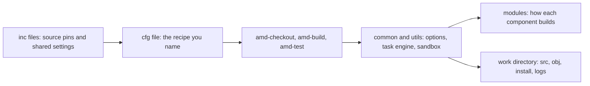

# amd-scripts

Development scripts for building, testing and comparing AMDGPU compiler
toolchains: LLVM/AOMP-style stacks with their supporting ROCm components, plus
GCC OpenMP offload toolchains.

These scripts are a development aid, **not** an official product build. The
official AOMP build lives at [ROCm/aomp](https://github.com/ROCm/aomp), and the
official ROCm build is [ROCm/TheRock](https://github.com/ROCm/TheRock).
amd-scripts can drive either of those (see
[Delegated AOMP builds](#delegated-aomp-builds) and
[TheRock builds](#therock-builds)), but its own native configs are the part
that gets the most use.

Design goals:

- **Ergonomic for development.** Rebuild one component, rerun one testsuite,
  bisect an old release, without re-running an hour-long script.
- **No hidden state.** Everything is determined by the config file you name on
  the command line plus the directory you run from. No environment variables to
  remember, no `source setenv.sh`.
- **Never clobber sources.** Source, build and install trees are separate; even
  testsuites are copied out of the source tree before running.
- **Repeatable.** Builds run under `bubblewrap` with the system's `/opt/rocm`
  and the network hidden, so a build can't silently pick up host ROCm bits.
- **Multiple configurations.** Current and historic AOMP/ROCm combinations,
  upstream LLVM, and GCC, side by side in different work directories.

The scripts are mostly used on Linux developer machines with AMD GPUs. They
assume `git`, `cmake`, `ninja`, `ccache` and `bwrap` (bubblewrap) are installed;
builds will fail in confusing ways if they are missing.

## Contents

- [The scripts are written in YSH](#the-scripts-are-written-in-ysh)
- [Setup](#setup)
- [Work directory layout](#work-directory-layout)
- [Quick start](#quick-start)
- [Choosing a config](#choosing-a-config)
- [amd-checkout](#amd-checkout)
- [amd-build](#amd-build)
- [Selecting tasks](#selecting-tasks)
- [Build options](#build-options)
- [The bubblewrap sandbox](#the-bubblewrap-sandbox)
- [Optional modules and removable features](#optional-modules-and-removable-features)
- [amd-test](#amd-test)
- [Comparing test results](#comparing-test-results)
- [Delegated AOMP builds](#delegated-aomp-builds)
- [TheRock builds](#therock-builds)
- [GCC offload toolchains](#gcc-offload-toolchains)
- [How configs work](#how-configs-work)
- [Adding a component](#adding-a-component)
- [Other utilities](#other-utilities)
- [Troubleshooting](#troubleshooting)

## The scripts are written in YSH

`amd-checkout`, `amd-build`, `amd-test` and everything they load are
[YSH](https://oils.pub/) programs (`#!/usr/bin/env ysh`), part of the Oils
project. YSH is a shell, so running commands looks familiar, but it also has
real lists, dicts, typed expressions and fail-fast error handling, which is what
the config files rely on.

You do not need to know YSH to *use* the scripts. To modify a config or a
module, these are the relevant upstream references:

- [Oils reference](https://oils.pub/release/latest/doc/ref/index.html)
- [A tour of YSH](https://oils.pub/release/latest/doc/ysh-tour.html)
- [Guide to procs and funcs](https://oils.pub/release/latest/doc/proc-func.html)
- [Egg expressions (regexes)](https://oils.pub/release/latest/doc/eggex.html)
- [YSH fixes shell's error handling](https://oils.pub/release/latest/doc/error-handling.html)

## Setup

Clone the repository:

```bash
git clone <TODO: repository URL> amd-scripts
```

Install the YSH interpreter:

```bash
amd-scripts/setup_prereq
```

`setup_prereq` is a plain Bash script. It downloads and builds
`oils-for-unix` (currently pinned to 0.37.0), and builds GNU readline first if
your system does not have a usable one. Three environment variables control
where it puts things:

| Variable   | Default          | Meaning                     |
|------------|------------------|-----------------------------|
| `DOWNLOAD` | `$HOME/downloads`| Where tarballs are fetched  |
| `PREFIX`   | `$HOME/prefix`   | Install prefix              |
| `BUILD`    | `$HOME/build-oil`| Scratch build directory     |

Add the install prefix to your `PATH`, as the script tells you to:

```bash
export PATH="$HOME/prefix/bin:$PATH"
```

`setup_prereq` does not install `ninja`, `ccache` or `bubblewrap`; use your
distribution's packages for those.

## Work directory layout

Everything is relative to the directory you run the scripts *from*, which the
scripts call the work directory. Create one work directory per configuration
you care about and always run from its top level:

```text
my-workdir/
  src/          checkouts (one directory per component, plus git worktrees)
  obj/          build trees, one per component
  install/      the resulting toolchain
  logs/         one log file per task: NNN-component_task.log
  testresults/  .json and .sum result files, plus report.txt
  archives/     downloaded tarballs, for components fetched as archives
```

The scripts create these as needed. Nothing is written outside the work
directory except the source checkouts' own git metadata, the ccache cache and
downloads.

Configs are named by their path relative to the `configs/` directory in this
repository, so `aomp/23/amd-staging-rocm-7.2.cfg` means
`amd-scripts/configs/aomp/23/amd-staging-rocm-7.2.cfg`. The config name is
always the first non-option argument.

## Quick start

Build a current AOMP-like stack (LLVM from `amd-staging`, plus the ROCm 7.2
components it needs):

```bash
mkdir ~/work/aomp23 && cd ~/work/aomp23

amd-checkout aomp/23/amd-staging-rocm-7.2.cfg
amd-build    aomp/23/amd-staging-rocm-7.2.cfg
amd-test     aomp/23/amd-staging-rocm-7.2.cfg
```

The examples here assume the scripts are on your `PATH`; otherwise call them by
path, as in `~/amd-scripts/amd-build`. What matters is the directory you run
*from*, not where the scripts live.

The checkout takes a while (LLVM plus a dozen ROCm repositories). The build
prints one line per task as it starts and finishes, and sends the actual build
output to `logs/`, so watch progress with:

```bash
tail -f logs/019-llvm_configure.log
```

The compiler ends up in `install/`, with LLVM itself under `install/lib/llvm`
for AOMP-style configs.

To work on upstream LLVM patches while still building the full ROCm stack, use a
`mainline+amd-staging` config instead:

```bash
amd-checkout aomp/23/mainline+amd-staging-rocm-7.2.cfg
```

This checks out upstream `main` and shares the clone with an `amd-staging`
worktree, because the ROCm components need the `amd` directory that only exists
on `amd-staging`:

```console
$ git -C src/llvm-project-amd-staging worktree list
/home/me/work/mainline/src/llvm-project-main         a4d95c27171e [main]
/home/me/work/mainline/src/llvm-project-amd-staging  d17d21e9ece8 [amd-staging]
```

Building and testing then work exactly as above.

## Choosing a config

`configs/` is organised by family and version. The most useful starting points:

| Goal | Config |
|------|--------|
| Current AOMP-like stack | `aomp/23/amd-staging-rocm-7.2.cfg` |
| Upstream LLVM `main` with the ROCm stack | `aomp/23/mainline+amd-staging-rocm-7.2.cfg` |
| Previous ROCm release | `aomp/22/amd-staging-rocm-7.1.cfg` |
| ROCm stack without the full AOMP test matrix | `rocm/6.3/rocm-6.3.cfg` |
| Upstream LLVM only, no ROCm components | `llvm/mainline.cfg` |
| GCC OpenMP offload | `gcc/amdgcn-gcc-mainline.cfg` |
| Build with the official AOMP scripts | `aomp/22/delegate-rocm-7.1.cfg` |
| Build with TheRock (experimental) | `tr/amd-staging/amd-staging.cfg` |

Naming conventions inside `configs/aomp/<version>/`:

- `amd-staging-rocm-X.Y.cfg` — LLVM `amd-staging` plus the ROCm X.Y components.
- `mainline+amd-staging-rocm-X.Y.cfg` — as above, but LLVM comes from upstream
  `main`, with an `amd-staging` worktree alongside for the `amd` directory.
- `delegate-rocm-X.Y.cfg` — build the same sources using AOMP's own scripts.

Older trees (`aomp/15` through `aomp/22`, `rocm/5.2` through `rocm/7.1`) are
kept for archaeology: reproducing and bisecting behaviour in released compilers.
`configs/misc/llvm-mos.cfg` is an unrelated experiment that happens to be a good
minimal example of the config format.

## amd-checkout

```bash
amd-checkout [options] <config> [component ...]
```

Clones or updates everything the config needs into `src/`. Components come in
several flavours, handled transparently: plain git clones (optionally shallow,
optionally with submodules), tarball downloads verified by MD5, git worktrees
sharing a parent clone, and "subcomponents" that are just a subdirectory of
another checkout.

Re-running `amd-checkout` updates existing checkouts, but conservatively. It
only runs `git pull --rebase` when the checkout is on the expected branch of the
expected remote, has no local modifications and no local commits. Anything else
is left alone and listed at the end under "Skipped updates", so your in-progress
work is never rebased or discarded behind your back.

Naming components after the config restricts the operation to those components,
which is useful when you have added an optional module later on:

```bash
amd-checkout aomp/23/amd-staging-rocm-7.2.cfg rocgdb
```

Note that this takes *component names*, unlike `amd-build` and `amd-test`, which
take task specifiers.

Two options matter at checkout time:

- `--add`/`-A` — optional modules can add components, so pass the same `--add`
  list you intend to build with (see
  [Optional modules](#optional-modules-and-removable-features)).
- `--ghuser` — required by `llvm/mainline.cfg`, which clones
  `git@github.com:<user>/llvm-project.git`. Pass your GitHub username, or
  `--ghuser llvm` for the upstream repository.

`amd-checkout` does not use the sandbox: it needs the network.

## amd-build

```bash
amd-build [options] <config> [task ...]
```

Builds and installs components in dependency order. Dependencies are declared
per component and topologically sorted, so the task list is derived, not
hand-maintained.

With no task arguments it runs everything. The `list` pseudo-task shows what
that would be:

```console
$ amd-build aomp/23/amd-staging-rocm-7.2.cfg list
001: rocm_cmake/clean
002: rocm_cmake/configure
003: rocm_cmake/install
004: rocr_runtime_patch/modify
005: rocsmilib/clean
...
018: llvm/clean
019: llvm/configure
020: llvm/build
021: llvm/install
022: llvm/install_filecheck
...
064: hipify/install
```

Each task writes to `logs/NNN-component_task.log`, named after its number and
task. If a task fails, the script prints the last 20 lines of that log and
stops.

Some task names look odd on purpose. `rocr_runtime_patch/modify` and
`rocr_runtime_unpatch/restore` bracket the LLVM build: a couple of components
need to be patched or symlinked into place while LLVM configures, and undone
afterwards. They are named so that the globs `modify` and `restore` select all
of them at once (see below).

## Selecting tasks

Any arguments after the config select which tasks to run. They are processed
left to right, so you can combine them.

| Specifier | Meaning |
|-----------|---------|
| *(none)* | Run everything (equivalent to `1 continue`) |
| `list` | Print the numbered task list and exit |
| `20` | Run task 20 |
| `20--22` | Run tasks 20 through 22 inclusive |
| `continue` | Run from the task after the previous one to the end |
| `llvm/build` | Run every task whose name contains this pattern |

A rebuild of just LLVM, with the patch/unpatch bracketing it, looks like this:

```bash
amd-build aomp/23/amd-staging-rocm-7.2.cfg modify llvm/{build,install} restore
```

and picking up where a failed build left off looks like this:

```bash
amd-build aomp/23/amd-staging-rocm-7.2.cfg 42 continue
```

Glob patterns are matched against the full task name as printed by `list`,
including the component: `llvm/build`, not `build_llvm`. Patterns are
substring matches, so `llvm` matches all LLVM tasks and `install` matches every
install task. **A pattern that matches nothing runs nothing, silently** — if a
command returns immediately without printing any task lines, check the pattern
against `list` output.

Brace expansion works either way: your shell expands `llvm/{build,install}`
before `amd-build` sees it, and quoted patterns like `'llvm/{build,install}'`
are brace-expanded internally.

Task numbers are stable for a given config and set of options, but adding
`--add`, `--clean` or another config changes them, so prefer name patterns in
anything you write down.

## Build options

These options are shared by `amd-build` and `amd-test`.

| Option | Effect |
|--------|--------|
| `-g`, `--debug` | Build everything with `CMAKE_BUILD_TYPE=Debug` |
| `--debug=comp1,comp2` | Debug for named components only |
| `--assertions=comp1,comp2` | Enable assertions for named components |
| `-j N`, `-jN` | Build parallelism (default: Ninja's own choice, or 32 for Make) |
| `-C`, `--clean` | Delete the contents of `install/` first, as an extra task |
| `-A`, `--add mod1,mod2` | Enable optional modules |
| `-R`, `--remove feat1,feat2` | Disable default features |
| `-r`, `--rpath` | Use AOMP-style `$ORIGIN` rpaths in installed binaries |
| `-B`, `--no-bwrap` | Do not use the bubblewrap sandbox |
| `--share-net` | Keep network access inside the sandbox |
| `-H`, `--bind-homebrew` | Make Homebrew's `bwrap`, `ccache`, `makeinfo`, `ld.lld` available inside the sandbox |
| `-T`, `--toolsroot DIR` | Build against a minimal root filesystem instead of the host's |
| `--shell` | Start an interactive shell inside the sandbox instead of building |
| `--flang-name NAME` | Override the flang flavour (`classic`, `legacy`, ...) |
| `--ghuser USER` | GitHub username, for configs that clone a fork |
| `--showdep COMP` | Print where a component's dependency edges come from |

`-g` affects the configure step, so it does not take effect on an incremental
rebuild unless you re-run the component's `configure` task.

`-C` only empties `install/`; it does not touch build trees. Make sure there is
nothing you want in there. To clean a single component's build tree, run its
`clean` task.

Builds use Ninja and ccache by default, in `Release` mode. Individual configs
override this per component where required (a few components do not work with
Ninja and are built with Make instead).

`--shell` is handy when a build step fails and you want to reproduce it by hand
in the same environment:

```console
$ amd-build --shell aomp/23/amd-staging-rocm-7.2.cfg
*** This is a bubble-wrapped shell, unless you explicitly specified
*** -B/--no-bwrap on the command line.  Exit with ctrl-D.

$ ls /opt          # the system ROCm is not visible in here
homebrew
```

## The bubblewrap sandbox

`amd-build` and `amd-test` re-execute themselves inside
[bubblewrap](https://wiki.archlinux.org/title/Bubblewrap/Examples) unless you
pass `-B`. The sandbox exists to keep builds honest, and hides two things that
otherwise leak into results:

- **`/opt`** is replaced with an empty tmpfs, so a system `/opt/rocm` cannot be
  picked up by accident. `/usr/lib/cmake` is hidden too, when present.
- **The network** is unshared, so a build cannot quietly fetch anything.

The filesystem is otherwise bound read-only, with writable exceptions for the
work directory, `/tmp`, the ccache cache directory, and `$HOME/.parallel` (GNU
Parallel needs this for the smoke tests). `/dev/kfd` and `/dev/dri` are bound
through so GPU tests work.

When something does not work under the sandbox, the usual escape hatches are:

- `-B`/`--no-bwrap` for a component whose configure step needs to fetch git
  submodules, or a testsuite that legitimately needs the system ROCm. Run that
  one step with `-B`, then continue normally.
- `--share-net` to keep the sandbox but allow network access.
- `~/.config/amd-scripts/bwrap-opts`, a file of extra `bwrap` arguments that is
  appended to every invocation, for host-specific fixes.

Delegated AOMP and TheRock builds enable network access themselves, because
those build systems fetch sources and Python packages as they go.

## Optional modules and removable features

Configs keep the default component set fairly lean. `--add` enables extra
components, testsuites or build features; `--remove` turns off things that are on
by default. Both take comma-separated lists and use underscores, never hyphens:

```bash
amd-checkout --add flang_legacy,rocgdb aomp/23/amd-staging-rocm-7.2.cfg
amd-build   --add flang_legacy,rocgdb aomp/23/amd-staging-rocm-7.2.cfg
```

Pass the same list to every command, since the modules change which components
and tasks exist. An unknown name is an error, so typos are caught immediately.

For AOMP-family configs (`configs/aomp/aomp-common.inc`):

| Module | Adds |
|--------|------|
| `flang`, `flang_legacy` | Fortran compiler components and their testsuite |
| `openmp_legacy` | Builds OpenMP the old way, for pre-`offload` LLVM revisions |
| `installdir_legacy` | Installs LLVM at the top of `install/`, not `install/lib/llvm` |
| `rocgdb`, `rocprofiler`, `rocprofiler_sdk`, `roctracer` | Debugger and profiling tools |
| `composable_kernel` | Composable Kernel (very slow to build) |
| `hrx_system` | The HRX alternative HIP runtime |
| `taskgraph` | Experimental OpenMP taskgraph support in libomp |
| `gpu_libc` | Adds `libc` to the GPU runtimes |
| `smoke_dev`, `openmp_examples`, `genasis` | Extra testsuites |

Removable with `-R`: `flang_new`, `flang_rt`, `clang_tools_extra`,
`spirv_translator`.

`llvm/mainline.cfg` adds `openmp_project` (build OpenMP as a project rather than
a runtime, for old revisions), `sollve_vv` and `taskgraph`. `rocm/6.3/rocm-6.3.cfg`
adds `rocgdb`, `rocprofiler` and `composable_kernel`. The delegated and TheRock
configs have their own lists, described in their sections below.

## amd-test

```bash
amd-test [options] <config> [task ...]
```

`amd-test` shares the task engine, the option set and the sandbox with
`amd-build`, so everything in [Selecting tasks](#selecting-tasks) applies. Its
task list is flat — one task per testsuite, bracketed by a clean and a save
step:

```console
$ amd-test aomp/23/amd-staging-rocm-7.2.cfg list
001: clean_test_dirs
002: test_llvm_llvm
003: test_llvm_clang
004: test_llvm_libclang_python
005: test_llvm_flang
...
013: test_aomp_examples
014: test_aomp_smoke
...
022: test_misc_sollve_vv
023: test_misc_nekbone
024: test_misc_ovo
025: save_test_results
```

There are three groups: `test_llvm_*` are LLVM's own lit testsuites,
`test_aomp_*` run through AOMP's test scripts, and `test_misc_*` are external
suites (SOLLVE V&V, Nekbone, OvO and so on).

Results accumulate. `clean_test_dirs` is the only thing that removes them, so
you can iterate on one suite and keep everything else intact:

```bash
amd-test aomp/23/amd-staging-rocm-7.2.cfg clean_test_dirs test_aomp_smoke save
```

`save_test_results` parses each suite's native output format and writes
DejaGNU-style `.sum` files into `testresults/`, plus a `report.txt` summary that
is also printed at the end of the run.

Some test sources are checked out but not wired into the default suites (Kokkos,
QMCPack, BabelStream, RAJAPerf and others, listed in the
`configs/aomp/*/aomp-tests-*.inc` files). They are there for manual use.

### Selecting individual tests

`-S`/`--select` narrows a testsuite, but the syntax follows whatever the
underlying suite supports:

| Suite | `--select` takes |
|-------|------------------|
| `test_llvm_*` | A **regex**, passed to lit as `LIT_FILTER` |
| `smoke`, `smoke_fails`, `smoke_limbo`, `smoke_dev`, `usm`, `omp5` | A **glob** matching test names |
| `llnl` | A glob, filtering the suite's test list |
| `sollve_vv` | `4.5`, `5.0`, `5.1` or `5.2` for an OpenMP version, otherwise a glob matching one test |
| `examples`, `hip_openmp`, `openmpapps`, `nekbone`, `openmp_examples` | Not supported (the run errors out) |

```bash
amd-test -S 'target_map.*' aomp/23/amd-staging-rocm-7.2.cfg test_llvm_offload
amd-test -S 5.2 aomp/23/amd-staging-rocm-7.2.cfg test_misc_sollve_vv
```

### GPU selection

Tests that run on hardware can be routed with `--gpurun=<args>` (passed to
`gpurun` from the install tree), `--gpu-offset N` (sets `GPURUN_DEVICE_BIAS`)
and `--gpu-devices a,b` (sets `ROCR_VISIBLE_DEVICES`). These are useful for
sharing a multi-GPU machine.

## Comparing test results

Because the `.sum` files are DejaGNU-shaped, a before-and-after comparison is
just:

```bash
amd-test aomp/23/amd-staging-rocm-7.2.cfg
mv testresults testresults-baseline

# ...change the compiler, rebuild...
amd-build aomp/23/amd-staging-rocm-7.2.cfg modify llvm/{build,install} restore
amd-test  aomp/23/amd-staging-rocm-7.2.cfg

compare-tests testresults-baseline testresults
```

`compare-tests` reports tests that changed state in either direction, grouped by
severity (a pass becoming a failure is highlighted more loudly than a failure
becoming unsupported), and notes result files present on only one side. GCC's
own `compare_tests` script also works on these files.

To see why an individual lit test failed, pull its output back out of the JSON
that lit wrote:

```bash
extract_test_output testresults/clang.json 'some/test/name'
```

The second argument is a glob matched against test names, so it can dump one
test or a whole directory's worth.

## Delegated AOMP builds

A delegated build runs AOMP's own `build_*.sh` scripts, but under amd-scripts.
Compared to running them directly you get the sandbox (no system `/opt/rocm`, a
pseudo home directory at `/home/aomp` inside the work directory), per-step logs,
and the ability to re-run individual steps.

Delegated builds share sources with the corresponding native config, so check
out that config, not the delegate:

```bash
amd-checkout --add flang_legacy,rocgdb aomp/22/amd-staging-rocm-7.1.cfg
amd-build -C aomp/22/delegate-rocm-7.1.cfg
```

Running `amd-checkout` on a `delegate-*.cfg` prints this instruction and exits.

The component list is probed by asking `build_aomp.sh` what it would build;
dependency ordering and task selection are then handled by amd-scripts as usual.
Tasks are named `ao_*`, for example `ao_rocm_smi_lib/cmake`,
`ao_rocm_smi_lib/build`, `ao_rocm_smi_lib/install`.

`--remove` turns off parts of the AOMP build: `cuda`, `debug`, `perf`,
`sanitizer`, `flang_classic` (also spelled `flang_legacy`) and `flang_new`.
`--add taskgraph` and `--add smoke_dev` are also available.

Testing works the same as for a native build; the test tasks know how to find
the delegated build's LLVM build directory.

## TheRock builds

Support for [TheRock](https://github.com/ROCm/TheRock) is experimental. The
current configs are `tr/amd-staging/amd-staging.cfg` and
`tr/amd-mainline/amd-mainline.cfg`.

```bash
amd-checkout tr/amd-staging/amd-staging.cfg
amd-build tr/amd-staging/amd-staging.cfg list
amd-build tr/amd-staging/amd-staging.cfg
```

amd-scripts reads TheRock's own CMake configuration to discover the component
list, their dependencies and other metadata, then gives each one the usual
`clean`, `configure`, `build`, `stage` and `dist` tasks under a `tr_<component>`
name, for example `tr_amd_llvm/build`. Running a task either invokes the
corresponding top-level target (`<component>+build` and friends) or, once
`build.ninja` exists, runs `ninja` in the component's build directory.

By default only the compiler is enabled. `--add` maps onto TheRock's feature
flags, for example:

```bash
amd-build --add fft,solver,composable_kernel tr/amd-staging/amd-staging.cfg
amd-build --debug=amd-llvm tr/amd-staging/amd-staging.cfg
```

Available names include `compiler`, `core_runtime`, `hip_runtime`,
`ocl_runtime`, `blas`, `fft`, `rand`, `solver`, `sparse`, `prim`, `math_libs`,
`ml_libs`, `miopen`, `rccl`, `composable_kernel`, `hipify`, `rocprof`,
`rocprofv3`, `rocprofsys`, `rdc`, `sysdeps` and several small third-party
libraries.

Two caveats. TheRock fetches sources and Python packages during the build, so
these configs do not isolate the network. And because the underlying targets
pull in their dependencies, an individual task can do considerably more work
than its name suggests.

## GCC offload toolchains

Three configs build a GCC with AMDGCN OpenMP offload support:

- `gcc/amdgcn-gcc-mainline.cfg` — GCC trunk
- `gcc/amdgcn-gcc-og14.cfg` — the `devel/omp/gcc-14` development branch
- `gcc/amdgcn-gcc-og13.cfg` — the older `devel/omp/gcc-13` branch

They build GMP/MPFR/MPC/ISL, a minimal LLVM (for `lld` and the assembler), the
ROCm runtime bits GCC needs, then the offload compiler and newlib, then the host
compiler:

```bash
amd-checkout gcc/amdgcn-gcc-mainline.cfg
amd-build gcc/amdgcn-gcc-mainline.cfg
```

Using the result:

```bash
export PATH=$PWD/install/bin:$PATH
export LD_LIBRARY_PATH=$PWD/install/lib64:$LD_LIBRARY_PATH

x86_64-linux-gnu-gcc -fopenmp -foffload-options=-march=gfx90a test.c -o test
./test

GCN_DEBUG=1 ./test    # offload debug output
```

(The install tree has both `lib` and `lib64`, which is a wart.)

Testing runs the DejaGNU suites (`c`, `cxx`, `fortran`, `libstdcxx`, `libgomp`),
with the target board set from the first GPU found on the machine:

```bash
amd-test gcc/amdgcn-gcc-mainline.cfg
```

## How configs work

Three kinds of file are involved:



- **`.cfg`** is an entry point: the thing you name on the command line.
- **`.inc`** files are reusable fragments, `source`d by configs. This is where
  repository URLs and branches live, so several configs can share one set of
  ROCm 7.2 pins.
- **`modules/*`** define how a component is built: its dependencies, where its
  source lives, and its tasks. There is roughly one file per component, and
  `common` loads all of them.

`configs/misc/llvm-mos.cfg` is short enough to read in full and shows the whole
config API:

```bash
var llvm_src = {
  "url" : "https://github.com/llvm-mos/llvm-mos.git",
  "type" : "git",
  "version" : "main",
  "version_name" : "mos",
  "shallow_clone" : false
}

add_sources ("llvm", llvm_src)
...
add_components llvm llvm_mos_sdk

set_configure_key ("llvm", "projects", :| clang lld |)
set_configure_key ("llvm", "targets", :| X86 |)
set_configure_key ("llvm", "runtimes", :| compiler-rt |)
append_configure_opts ("llvm", :| -DLLVM_EXPERIMENTAL_TARGETS_TO_BUILD="MOS"
                                  -DLLVM_OPTIMIZED_TABLEGEN=1
                                  -DLIBXML2_LIBRARIES=IGNORE
                                  -DLLVM_ENABLE_ASSERTIONS=ON |)
```

The main entry points a config can use:

| Call | Purpose |
|------|---------|
| `add_sources (name, dict)` | Where a component's source comes from (`git`, `archive`, `worktree`, `subcomponent`) |
| `add_components a b c` | Build these, and everything they depend on |
| `add_testsuites group s1 s2` | Register testsuites, creating `test_<group>_<suite>` tasks |
| `set_configure_key (comp, key, value)` | Set a named knob a module understands, e.g. LLVM's `projects`, `runtimes`, `targets`, `gfxlist` |
| `set_configure_opts` / `append_configure_opts` | Raw configure or CMake arguments |
| `set_build_tool (comp, tool)` | Override Ninja for a component |
| `add_config_adjustment { ... }` | Defer a block until after `--add`/`--remove` have been processed |
| `add_checkout_adjustment { ... }` | Run a block after checkout, e.g. to switch branches |
| `func <comp>_conditional_deps()` | Extra dependencies that depend on the configuration |

A real config is mostly `source` lines assembling these fragments. For example
`configs/aomp/23/amd-staging-rocm-7.2.cfg` pulls in the LLVM `amd-staging`
sources, the ROCm 7.2 component pins, the AOMP test sources, the supporting
libraries, and finally `aomp/aomp-common.inc`, which defines the default
component set, the default testsuites and the `--add`/`--remove` handling shared
by all AOMP configs.

Order matters in one respect: conditional dependency functions must be defined
before the component that uses them is added, which is why configs sometimes
define a `func` between two `source` lines.

## Adding a component

1. Write `modules/<name>`, providing `get_<name>_src()`,
   `<name>_dependencies()` and `<name>_tasks`. Most components can use
   `standard_tasks <name>` plus the generic `cmake_build` or `standard_build`
   (autotools) helpers, in which case the module is a dozen lines.
2. Add a `source "$SCRIPTDIR/modules/<name>"` line at the bottom of `common`.
3. In the config or `.inc`, call `add_sources` with the repository details, then
   either `add_components <name>` for a default component or add a case to that
   config's `add_optional_module` proc to make it opt-in.

Check the result with `amd-build <config> list` before building: the task list
shows whether the component landed in the right place in the dependency order.
`--showdep <name>` explains where its dependency edges came from.

## Other utilities

`convert-manifest` turns a ROCm repo manifest into config fragments, which is
how the per-version `.inc` files get bootstrapped:

```bash
cd src/aomp-aomp_dev/manifests
convert-manifest test_19.0.xml
```

It needs the `xq` command from the **`python-yq`** package (a jq wrapper for
XML). There is an unrelated Go program also called `xq` that does not work here;
the script checks and tells you if it finds the wrong one.

## Troubleshooting

**A build step fails.** The last 20 lines of the log are printed; the full log
is `logs/NNN-component_task.log`. Reproduce the environment with
`amd-build --shell <config>`, or re-run just that task by number or name once
you have a fix.

**A configure step wants the network.** Some components fetch git submodules
while configuring. Run that step once with `-B`, then continue.

**A testsuite needs the system ROCm.** Run `amd-test` with `-B` so `/opt/rocm`
is visible.

**A task specifier does nothing.** Patterns match the `component/task` names
printed by `list`, so `llvm/build` works where `build_llvm` matches nothing.

**Checkout says "Skipped updates".** Those checkouts had local commits,
uncommitted changes, or an unexpected branch or remote. That is deliberate;
resolve it in the checkout yourself if you did want it updated.

**cmake finds the wrong thing.** Check whether it lives in `/opt` or
`/usr/lib/cmake`, both of which the sandbox hides. If a build only works outside
the sandbox, that difference is usually the reason.
